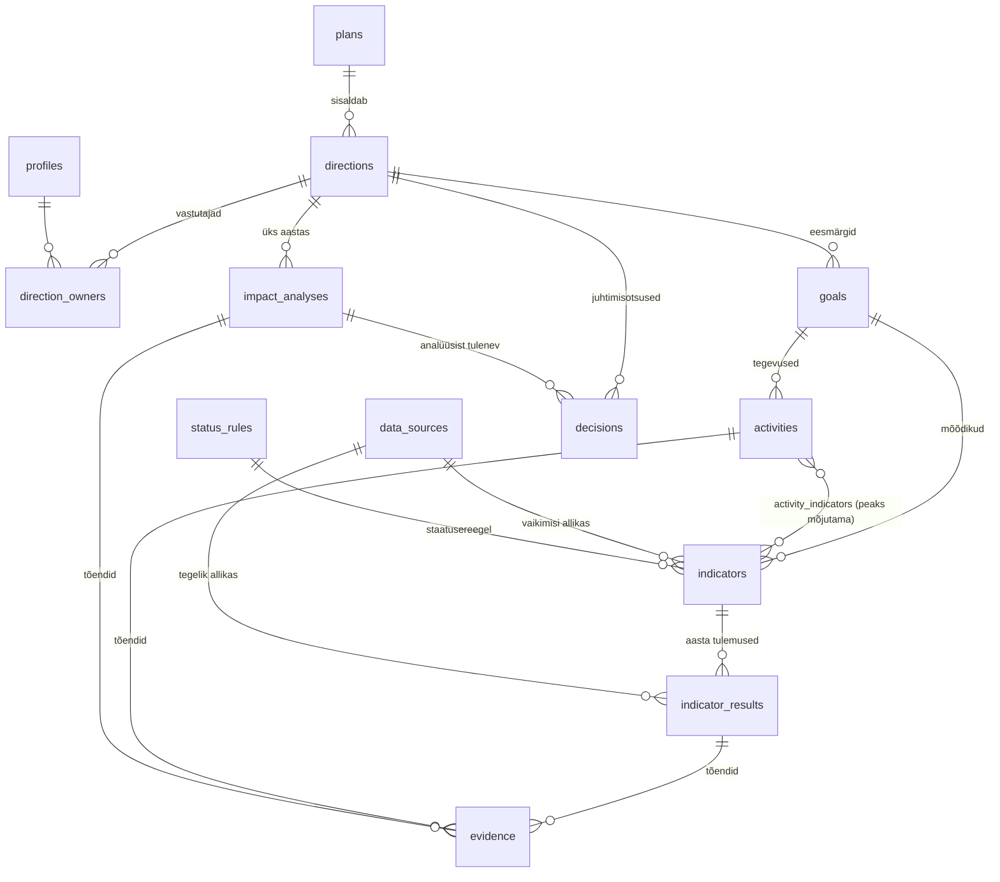

# 2. Andmemudel

## Olemid ja seosed



Hierarhia: **arengukava → arengusuund (3) → eesmärk → mõõdik → aastatulemus**. Tegevused kuuluvad eesmärgi alla ja on seotud mõõdikutega, mida nad peaksid mõjutama — nii on igal tegevusel nähtav „miks me seda teeme“.

Eesmärgi tasand on vajalik **andmelünga** jaoks: arengusuunas võib olla eesmärk („õpilane oskab kasutada õppimisstrateegiaid“), millel veel mõõdikut pole. Süsteem näitab selle eraldi.

## Sõnastik (andmebaas ↔ kasutajaliides)

| Andmebaas | Kasutajaliides |
|---|---|
| `plans` | arengukava |
| `directions` | strateegiline arengusuund |
| `direction_owners` | arengusuuna vastutaja(d) |
| `goals` | eesmärk |
| `indicators` | mõõdik |
| `indicators.kind` = `outcome` / `process` | tulemusnäitaja / protsessinäitaja |
| `indicators.impact_level` = `practice` / `learner_reach` / `learner_result` | praktika muutus / jõudis õppijani / õppija tulemus või kogemus |
| `indicators.direction` = `increase` / `decrease` / `maintain` | kasv / langus / säilimine |
| `indicator_results` | vahetulemus (aasta) |
| `data_sources` | andmeallikas |
| `status_rules` | staatusereegel |
| `activities` | tegevus |
| `evidence` | tõendusmaterjal |
| `impact_analyses` | aasta mõjuanalüüs |
| `decisions` | juhtimisotsus / tegevuskava muudatus |

## Nõuete katvus

| Nõue | Kus |
|---|---|
| eesmärgi nimetus, lähtekoht, soovitud muutus, mõju õppijale | `directions.title / starting_point / desired_change / learner_impact` (+ samad väljad eesmärgi tasandil) |
| tulemus- ja protsessinäitajad | `indicators.kind` |
| algtase, sihttase | `indicators.baseline_value / baseline_year / target_value / target_year` |
| vahetulemused aastate kaupa | `indicator_results (indicator_id, year)` – unikaalne |
| andmeallikas | `data_sources`, `indicators.source_id`, vajadusel ülekirjutus `indicator_results.source_id` |
| vastutaja | `direction_owners` (õigused), `indicators.owner_id`, `activities.owner_id` |
| seotud tegevused, tähtajad | `activities`, `activity_indicators`, `due_date` |
| tõendusmaterjalid | `evidence` (link või fail) |
| kommentaarid ja juhtimisotsused | `indicators.description`, `indicator_results.comment`, `decisions` |
| ühik, trendisuund, selgitav kommentaar | `indicators.unit / direction / description` |
| andmete päritolu ja sisestuskuupäev | `indicator_results.source_id / measured_on / entered_by / entered_at` |
| mõjuanalüüs 8 küsimusega, jääb ajalukku | `impact_analyses` + `snapshot`, kinnitatud analüüs on lukus |
| muudatused tegevuskavas ajajoonel | `decisions` (`kind`, `effective_year`, viide tegevusele/mõõdikule) |

## Staatuse arvutamine

Staatus arvutatakse **aruandeaasta** (vaikimisi jooksev aasta) kohta. Reegel on kasutaja määratav (`status_rules`), vaikimisi 75 / 40.

**1. Planeeritud areng seisuga aasta Y** (lineaarne algtasemest sihini):

```
planeeritud_osa = (Y − algtaseme_aasta) / (sihi_aasta − algtaseme_aasta)
```

Näide: algtase 2026, siht 2030, aruandeaasta 2027 → planeeritud_osa = 1/4 = 25%.

**2. Tegelik areng**:

```
saavutatud_osa = (tulemus_Y − algtase) / (siht − algtase)
täitmine_%     = saavutatud_osa / planeeritud_osa × 100
```

Valem töötab samamoodi kasvu ja languse puhul (languse korral on nii lugeja kui nimetaja negatiivsed).

**3. Värv**:

| Tingimus | Staatus |
|---|---|
| algtase või siht puudub | ⬜ hall (andmelünk) |
| aruandeaasta tulemus puudub | ⬜ hall („andmed puuduvad“, näidatakse viimast olemasolevat väärtust) |
| tulemus liikus algtasemest vales suunas (ja reeglis `red_on_negative`) | 🟥 punane |
| täitmine ≥ `green_min_pct` (75) | 🟩 roheline |
| `yellow_min_pct` (40) ≤ täitmine < 75 | 🟨 kollane |
| täitmine < 40 (sh muutus 0) | 🟥 punane |

**Säilimine** (`maintain`): roheline, kui tulemus ≥ siht − tolerants; kollane, kui ≥ siht − 2 × tolerants; muidu punane. (Eeldus: suurem on parem. Vt [kinnitamiseks](07-kinnitamiseks.md).)

Näide (näidisandmed): HARNO funktsionaalne lugemine 64 → siht 72, 2027 tulemus 66 → saavutatud 2/8 = 25%, planeeritud 25% → täitmine 100% → 🟩.

### Arengusuuna üldstaatus

Arvutatakse **tulemusnäitajatest**, millel on aruandeaasta andmed (protsessinäitajad kuvatakse eraldi tasandil „praktika“):

1. ⬜ hall — ühelgi tulemusnäitajal pole aruandeaasta andmeid
2. 🟥 punane — mõni **võtmenäitaja** (`is_key`) on punane **või** vähemalt pooled on punased
3. 🟩 roheline — ükski pole punane **ja** vähemalt 2/3 on rohelised
4. 🟨 kollane — muul juhul

### Mõjuahela signaal

Iga eesmärgi kohta võrreldakse tasandeid. Kui protsessinäitaja (praktika / jõudis õppijani) on 🟩, aga sama eesmärgi tulemusnäitaja 🟥, kuvatakse: **„Praktika muutus, kuid õppija tulemus mitte — vaata üle, kas tegevus jõuab õppijani.“** (Näidisandmetes S2.1: 74% arenguvestlustest lõpeb kokkuleppega, aga õpilaste „tean oma järgmist sammu“ langes; S3.1: KiVa tunnid toimuvad, aga turvatunne ei paranenud.)

## Andmelünk

Andmebaasi funktsioon `data_gaps(aasta)` tagastab neli lünga tüüpi:

| Tüüp | Teade |
|---|---|
| `no_outcome_indicator` | Eesmärgil „…“ puudub tulemusnäitaja → vaja luua mõõdik ja algtaseme mõõtmine |
| `no_baseline` | Mõõdikul „…“ puudub algtase → planeeri algtaseme mõõtmine |
| `no_target` | Mõõdikul „…“ puudub sihttase 2030 |
| `no_current_result` | Mõõdikul „…“ puudub aruandeaasta tulemus |

Lüngad kuvatakse juhtkonna vaates eraldi plokis ja arengusuuna vaates eesmärgi juures. Lünga juurest saab ühe klikiga luua mõõdiku või tegevuse („algtaseme mõõtmine“).

## Õigused

| | Administraator / koolijuht | Arengusuuna vastutaja | Vaatleja |
|---|---|---|---|
| Kõigi andmete lugemine | ✔ | ✔ | ✔ |
| Kasutajad, rollid, vastutajate määramine | ✔ | – | – |
| Andmeallikad, staatusereeglid | ✔ | – | – |
| Arengusuuna loomine/kustutamine | ✔ | – | – |
| Oma suuna kirjeldus, eesmärgid, mõõdikud, tulemused, tegevused, tõendid, otsused | ✔ | ✔ (ainult oma suund) | – |
| Mõjuanalüüsi mustand | ✔ | ✔ (oma suund) | – |
| Mõjuanalüüsi kinnitamine (lukustab) | ✔ | – | – |

Jõustatakse Postgres RLS-poliitikatega; kontrollitud lokaalselt (vastutaja ei saa muuta teise suuna tulemust ega kinnitada analüüsi; kinnitatud analüüsi ei saa vastutaja muuta; vaatleja ei saa midagi kirjutada).
